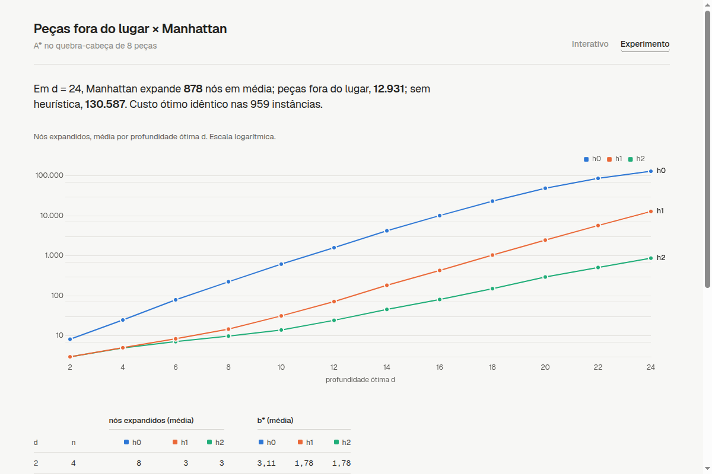
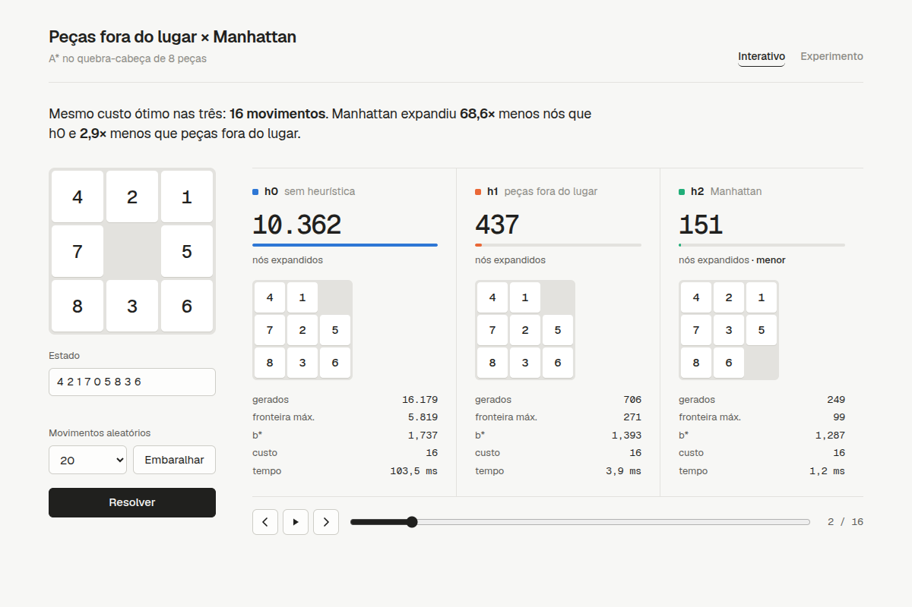

# A* no quebra-cabeça de 8 peças

Peças fora do lugar (h1) × distância de Manhattan (h2): qual das duas guia melhor a busca A*.

## Visão geral

Trabalho da disciplina Introdução à IA, Grupo 2. O enunciado: *"Como organizar as peças numeradas utilizando o menor custo de movimentos? Aplicar A\* comparando duas heurísticas: peças fora do lugar e distância de Manhattan. Demonstrar qual orientou melhor a busca."*

A demonstração tem duas partes:

- **Experimento em lote** (a prova): instâncias agrupadas por profundidade ótima d ∈ {2, 4, …, 24}, resolvidas por A* com cada heurística, no formato da tabela de Russell & Norvig (AIMA, cap. 3).
- **Interface web** (a ilustração): resolve um estado com as três heurísticas lado a lado e anima a solução.

O baseline é A* com h0 ≡ 0, que equivale a Dijkstra/UCS. O algoritmo é o mesmo nos três casos, então a única variável é a heurística. As duas heurísticas são admissíveis e ignoram o espaço vazio, então o custo encontrado é sempre o ótimo. Como h2 domina h1 (h2(n) ≥ h1(n) para todo n), h2 expande menos nós. O design completo está em [`design.md`](design.md).

## Organização

```
core/                 núcleo puro, sem dependências
  puzzle.py           estado (tupla de 9, 0 = vazio), vizinhos, validade, solvabilidade
  heuristics.py       h0, h1, h2
  astar.py            astar(start, h) -> Result(path, moves, metrics)
  branching.py        fator de ramificação efetivo b*
experiment/run.py     CLI offline: gera instâncias, roda as 3 heurísticas, exporta results/
results/              experiment.json (lido pela API) e experiment.csv
api/main.py           FastAPI: POST /api/solve, GET /api/experiment, front estático em /
web/                  front em JS puro + Chart.js, sem etapa de build
tests/                pytest: núcleo, busca e API
docs/img/             capturas de tela usadas neste README
design.md             especificação (fonte da verdade)
```

`core/` não importa nada de `api/`, `web/` ou `experiment/`.

## Ferramentas

- **Python ≥ 3.12**, gerenciado com [uv](https://docs.astral.sh/uv/) (`pyproject.toml`, `uv.lock`)
- **FastAPI** + **uvicorn** no servidor
- **pytest** + **httpx** (TestClient) nos testes
- **JavaScript puro** no front, **Chart.js 4.4.1** via CDN e fontes Geist / Geist Mono

## Resultados

Saída de `python -m experiment.run` com semente 0 (`results/experiment.csv`). Os valores são médias por profundidade. b* usa N = nós gerados (convenção AIMA).

| d | n | expandidos h0 | expandidos h1 | expandidos h2 | b* h0 | b* h1 | b* h2 |
|--:|--:|--:|--:|--:|--:|--:|--:|
| 2 | 4 | 8 | 3 | 3 | 3,11 | 1,78 | 1,78 |
| 4 | 16 | 25 | 5 | 5 | 2,20 | 1,34 | 1,34 |
| 6 | 39 | 80 | 8 | 7 | 2,01 | 1,26 | 1,22 |
| 8 | 100 | 225 | 15 | 10 | 1,90 | 1,25 | 1,17 |
| 10 | 100 | 623 | 32 | 14 | 1,84 | 1,29 | 1,15 |
| 12 | 100 | 1 603 | 72 | 25 | 1,80 | 1,33 | 1,17 |
| 14 | 100 | 4 244 | 184 | 46 | 1,77 | 1,37 | 1,19 |
| 16 | 100 | 10 184 | 433 | 81 | 1,73 | 1,39 | 1,21 |
| 18 | 100 | 23 438 | 1 050 | 152 | 1,70 | 1,41 | 1,23 |
| 20 | 100 | 49 185 | 2 483 | 297 | 1,66 | 1,42 | 1,24 |
| 22 | 100 | 86 854 | 5 747 | 513 | 1,62 | 1,43 | 1,25 |
| 24 | 100 | 130 587 | 12 931 | 878 | 1,58 | 1,44 | 1,26 |

As profundidades d = 2, 4 e 6 têm só 4, 16 e 39 instâncias porque esses são todos os estados que existem nessas profundidades. O custo ótimo foi o mesmo para h0, h1 e h2 em todas as 959 instâncias; o script verifica isso com `assert`. Uma nova execução com a mesma semente reproduz o JSON, exceto `time_ms`.





## Uso

```bash
uv sync

uv run pytest                        # testes (~8 s)
uv run python -m experiment.run      # regenera results/ (~100 s)
uv run uvicorn api.main:app          # http://localhost:8000
```

Opções do experimento: `--per-bucket` (padrão 100), `--h0-per-bucket` (limite para h0, a mais lenta), `--seed` (padrão 0), `--attempts-per-bucket`.

API:

- `POST /api/solve` com `{"state": [9 inteiros], "heuristic": "h0" | "h1" | "h2"}` retorna `{"path", "moves", "metrics"}`. Responde 422 se o estado for inválido ou insolúvel.
- `GET /api/experiment` retorna o conteúdo de `results/experiment.json`, ou 404 se o experimento ainda não foi gerado.

## Convenções de documentação

Docstrings Google-style em Python e JSDoc em JavaScript; templates e exemplos em [`CONTRIBUTING.md`](CONTRIBUTING.md).
